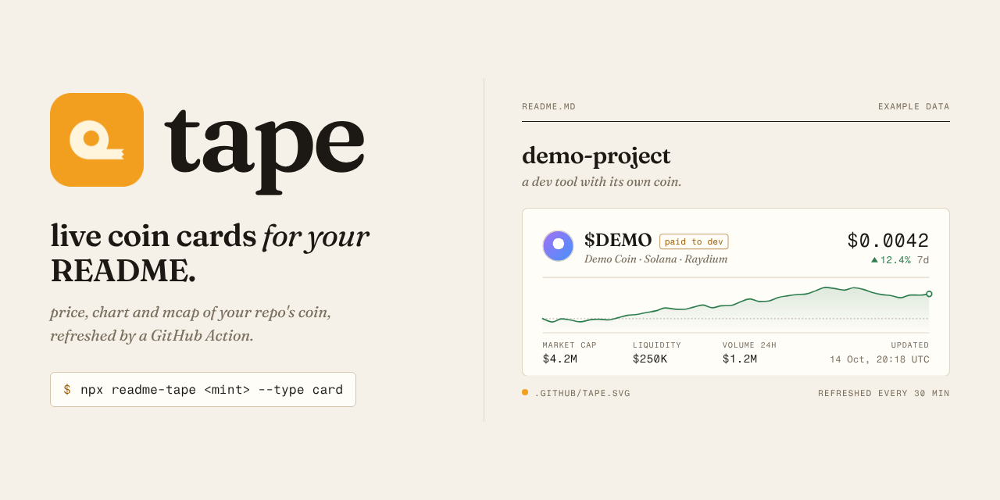
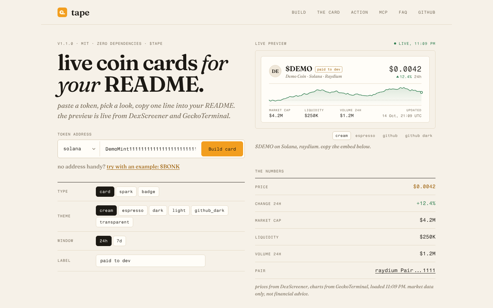
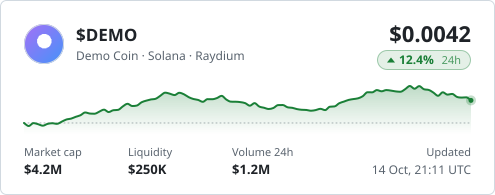
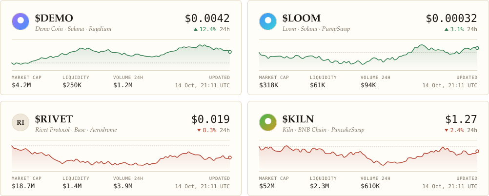
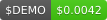
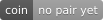
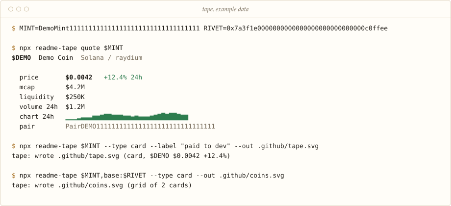
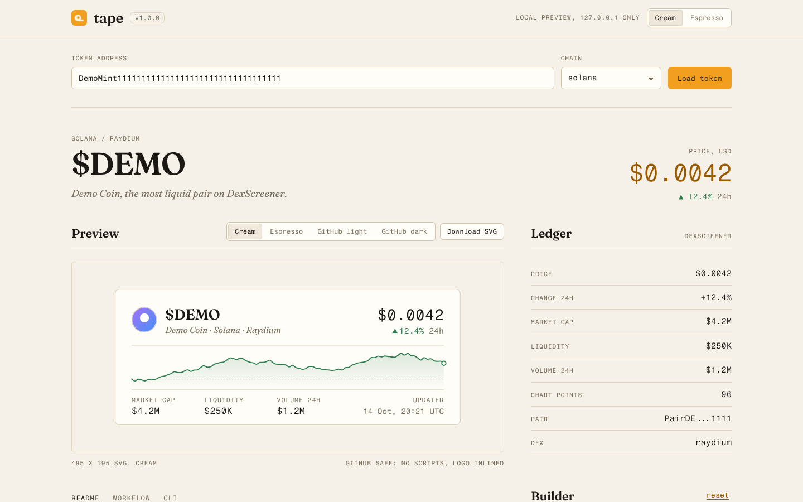
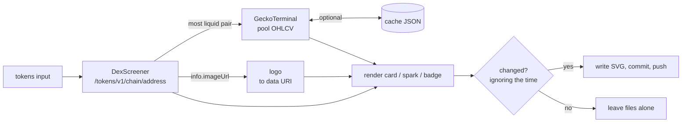

<p align="center">
  
</p>

<h1 align="center">
  &nbsp;tape
</h1>

<p align="center"><em>live coin cards for your README.</em><br>your repo's coin, its price, chart and mcap, as a plain SVG that a GitHub Action keeps fresh.</p>

<p align="center">
  <a href="LICENSE"></a>
  <a href="package.json"></a>
  <a href="package.json"></a>
  <a href="#mcp-server-use-it-from-an-ai-agent"></a>
</p>

<p align="center">
  <a href="https://readmetape.com">Website</a> &middot;
  <a href="#use-it-in-your-browser">Browser</a> &middot;
  <a href="#quick-start">Quick start</a> &middot;
  <a href="#github-action">Action</a> &middot;
  <a href="#cli-reference">CLI</a> &middot;
  <a href="#mcp-server-use-it-from-an-ai-agent">MCP</a> &middot;
  <a href="#dashboard-tape-ui">Dashboard</a> &middot;
  <a href="#programmatic-api">API</a> &middot;
  <a href="#faq">FAQ</a>
</p>

<p align="center">
  
</p>
<p align="center"><sub>example data from the test fixtures, not a real token.</sub></p>

## Use it in your browser

**[readmetape.com](https://readmetape.com)** is the builder: paste a token address, pick card, spark or badge and a theme, and the live preview renders right there from DexScreener and GeckoTerminal with tape's own renderer. Then copy one of two embeds:

- **hosted URL (one line)**: no Action, no install. The image is rendered on request and cached by the CDN for 5 minutes.

  ```markdown
  [](https://dexscreener.com/solana/YOUR_TOKEN_ADDRESS)
  ```

- **GitHub Action (self-hosted)**: the workflow below, with your options filled in, so the SVG lives in your repo.

Builder links are shareable: `https://readmetape.com/?token=<address>&chain=base&type=spark&timeframe=7d` opens with that preview loaded.



### Hosted endpoints

`GET /api/card`, `/api/spark` and `/api/badge` on readmetape.com answer `image/svg+xml` with `Cache-Control: public, s-maxage=300, stale-while-revalidate=600`.

| Query | Types | Default | Notes |
| --- | --- | --- | --- |
| `token` | all | | Address, or `chain:address`. Required. |
| `chain` | all | `solana` | DexScreener chain id. |
| `theme` | card | `dark` | `cream`, `espresso`, `dark`, `light`, `github_dark`, `transparent` |
| `timeframe` | card, spark | `24h` | `24h` or `7d` |
| `label` | all | | Up to 40 characters, for example `paid to dev` |
| `colors` | card | | `bg=fffdf8,accent=f29e1f` (keys as in the action) |
| `hide_border` | card | `0` | `1` hides the border |
| `token_logo` | card | `1` | `0` draws the monogram |
| `metric` | spark, badge | `price` / `all` | Spark: `price`, `change`. Badge: `price`, `mcap`, `change`, `volume`, `all` |
| `style` | spark, badge | `flat` | `flat`, `flat-square`, `for-the-badge` |
| `label_color` | spark, badge | | Hex, left side background |
| `logo` | spark, badge | | `solana` or `ethereum` |

Bad input answers HTTP 400 and an upstream failure 502 (503 when rate limited), each with a small grey "tape" badge as the body and the reason in the `x-tape-error` header. Token logos are only fetched from public https hosts. The functions need no environment variables; `TAPE_DEXSCREENER_API` and `TAPE_GECKO_API` (see [Configuration](#configuration)) work there too.

### Run the site locally

```sh
npm run site        # http://127.0.0.1:4180, live APIs
npm run site:mock   # same, against the mock APIs in fixtures/ (example data)
```

`scripts/dev-site.mjs` serves `docs/` and routes `/api/*` to the handlers the way Vercel does. The page renders with `docs/lib/`, a byte-for-byte copy of the browser-safe modules in `src/`; after changing those, run `npm run sync-site` (a test fails when the copies drift).

## What it does

Lots of repos have a coin now, usually from a launchpad that pays the dev a cut of the trading fees. tape puts that coin's live price, chart and mcap on the README, the way you'd tape a ticker to your monitor.

- one 495x195 SVG with logo, price, change, a 24h or 7d chart, market cap, liquidity and volume
- refreshed by a GitHub Action every 30 minutes (or your cron), committed only when a number moved
- no server needed, no API key, zero dependencies (or skip the Action and use the hosted URL)

## Quick start

1. Add [`examples/workflow.yml`](examples/workflow.yml) to your repository as `.github/workflows/tape.yml` and set your token address:

```yaml
name: tape
on:
  schedule:
    - cron: '*/30 * * * *'
  workflow_dispatch:
permissions:
  contents: write
concurrency:
  group: tape
  cancel-in-progress: true
jobs:
  tape:
    runs-on: ubuntu-latest
    steps:
      - uses: actions/checkout@v4
      - uses: OWNER/tape@v1
        with:
          tokens: YOUR_TOKEN_ADDRESS
          theme: cream
          label: paid to dev
```

2. Run it once from the Actions tab (`workflow_dispatch`) so `.github/tape.svg` exists.

3. Put it in your README, linked to the chart page if you like:

```markdown
[](https://dexscreener.com/solana/YOUR_PAIR)
```

Not on Solana? Prefix the address with the chain: `base:0x...`, `ethereum:0x...`, `bsc:0x...`, or set `chain`.

## Themes

Six card themes. `cream` and `espresso` are tape's own editorial look (serif symbol, mono figures, hairline rules). The others use a compact GitHub-style layout. Every colour can be overridden with a flag. All images below were rendered by the CLI against the mock APIs in `fixtures/` (`npm run examples`), so prices and names are example data.

| Theme | Card |
| --- | --- |
| `cream` |  |
| `espresso` |  |
| `dark` (default) |  |
| `light` |  |
| `github_dark` |  |
| `transparent` |  |
| custom colours |  |

To follow the reader's GitHub theme, render two files and let the browser pick:

```html
<picture>
  <source media="(prefers-color-scheme: dark)" srcset=".github/tape-espresso.svg">
  
</picture>
```

Several coins in one image (`--theme cream`, two columns):



Badges, for when a card is too much:

| Type | Example |
| --- | --- |
| `spark` |   |
| `spark`, `for-the-badge`, label |  |
| `badge`, `all` |  |
| `badge`, single metrics |    |
| `badge`, label |  |
| no pair yet |  |

## Install

The GitHub Action needs no install. For the CLI and the MCP server:

```sh
npx readme-tape --help        # run without installing
npm install -g readme-tape    # or install the tape command globally
npm install readme-tape       # or use the JavaScript API in a project
```

Node 18 or newer. No runtime dependencies.



## GitHub Action

### Inputs

| Name | Default | Description |
| --- | --- | --- |
| `tokens` | | Comma separated token addresses. Use `chain:address` to mix chains. |
| `token` | | A single address (kept for v0 workflows). Merged into `tokens`. |
| `chain` | `solana` | Default DexScreener chain id for addresses without a prefix. |
| `type` | `card` | `card`, `spark` or `badge`. |
| `theme` | `dark` | Card theme: `cream`, `espresso`, `dark`, `light`, `github_dark`, `transparent`. |
| `timeframe` | `24h` | Chart and change window: `24h` or `7d`. |
| `colors` | | Card colour overrides, `key=hex` pairs: `bg=fffdf8,accent=f29e1f`. Keys: `bg`, `border`, `text`, `muted`, `accent`, `up`, `down`. |
| `hide-border` | `false` | Card without its border. |
| `token-logo` | `true` | Embed the DexScreener token logo in cards. `false` draws a monogram. |
| `label` | | Card chip next to the symbol, or badge left text. For example `paid to dev`. |
| `label-color` | | Badge left background (hex). |
| `metric` | `all` / `price` | Badge: `price`, `mcap`, `change`, `volume`, `all`. Spark: `price`, `change`. |
| `style` | `flat` | Badge and spark style: `flat`, `flat-square`, `for-the-badge`. |
| `logo` | | Chain icon on badges and sparks: `solana` or `ethereum`. |
| `path` | `.github/tape.svg` | Output file. With several tokens the default is `.github/tape-{n}.svg`. Placeholders: `{n}`, `{chain}`, `{address}`, `{symbol}`. |
| `paths` | | Comma separated output files, one per token. |
| `grid` | | Extra file with all tokens in one grid SVG. |
| `columns` | `2` / `1` | Grid columns (2 for cards, 1 otherwise). |
| `cache` | | JSON file for chart data, for example `.github/tape-cache.json`. |
| `cache-ttl` | `10` | Minutes for which cached chart data counts as fresh. |
| `commit` | `true` | Commit and push when something changed. `false` only writes files. |
| `commit-message` | `chore: update tape` | Commit message. |

### Outputs

| Name | Description |
| --- | --- |
| `price` | Price in USD of the first token. Empty when it has no pair. |
| `mcap` | Market cap of the first token, falling back to FDV. |
| `change` | Change in percent of the first token over `timeframe`. |
| `svg-path` | Path of the first SVG. |
| `paths` | All token SVG paths, comma separated. |
| `changed` | `true` when any SVG changed. |
| `committed` | `true` when a commit was pushed. |
| `data` | JSON array: `chain`, `address`, `symbol`, `priceUsd`, `marketCap`, `change`, `timeframe`, `path` per token. |

### Several tokens

```yaml
      - uses: OWNER/tape@v1
        with:
          tokens: DemoMint1111111111111111111111111111111111, base:0x7a3f1e0000000000000000000000000000c0ffee
          path: .github/coins/{symbol}.svg
          grid: .github/coins/all.svg
          cache: .github/tape-cache.json
```

This writes `.github/coins/DEMO.svg`, `.github/coins/RIVET.svg` and `.github/coins/all.svg` and commits all three in one commit (when something changed).

## CLI reference

```text
tape <token> [options]           render one SVG (stdout or --out)
tape <token,token,...> [options] render several into one grid SVG
tape quote <token> [--json]      print market data and a 24h sparkline
tape ui [token] [--port 4178]    local preview gallery and builder
tape mcp                         MCP server over stdio for AI agents
```

A token is an address, or `chain:address`.

| Option | Description |
| --- | --- |
| `--type <name>` | `badge` (default), `card` or `spark` |
| `--chain <id>` | DexScreener chain id (default `solana`) |
| `--timeframe <tf>` | `24h` (default) or `7d` |
| `--theme <name>` | `dark` (default), `cream`, `espresso`, `light`, `github_dark`, `transparent` |
| `--bg`, `--border`, `--text`, `--muted`, `--accent`, `--up`, `--down <hex>` | Single card colour overrides |
| `--colors <list>` | The same as one list: `"bg=fffdf8,accent=f29e1f"` |
| `--hide-border` | Card without its border |
| `--no-logo` | Monogram instead of the token logo |
| `--label <text>` | Card chip or badge left text, for example `"paid to dev"` |
| `--label-color <hex>` | Badge left background |
| `--metric <name>` | Badge: `price`, `mcap`, `change`, `volume`, `all` (default). Spark: `price` (default), `change` |
| `--style <name>` | `flat` (default), `flat-square`, `for-the-badge` |
| `--logo <name>` | `solana` or `ethereum` icon on badges and sparks |
| `--columns <n>` | Grid columns (default 2 for cards, 1 otherwise) |
| `--cache <file>` | Reuse chart data younger than 10 minutes from a JSON file |
| `--out <file>` | Write to a file instead of stdout |
| `--json` | Print the loaded data instead of an SVG |
| `--port <n>` | Port for `ui` (default 4178) |
| `-h`, `--help` / `-v`, `--version` | Help and version |

```sh
# Card in the cream theme with a label
npx readme-tape <mint> --type card --theme cream --label "paid to dev" --out card.svg

# Sparkline badge showing the 7 day change
npx readme-tape base:0xYourToken --type spark --metric change --timeframe 7d > spark.svg

# Two coins side by side
npx readme-tape <mint>,bsc:0xOtherToken --type card --out coins.svg
```

Exit codes: `0` on success (a token with no pair yet still renders a "no pair yet" state), `1` when an API cannot be reached or returns an error, `2` for invalid usage.

## MCP server: use it from an AI agent

`tape mcp` starts a [Model Context Protocol](https://modelcontextprotocol.io) server over stdio (JSON-RPC 2.0, one message per line). Add it to Claude Desktop (`claude_desktop_config.json`), Claude Code (`.mcp.json`), Cursor or any other MCP client:

```json
{
  "mcpServers": {
    "tape": {
      "command": "npx",
      "args": ["-y", "readme-tape", "mcp"]
    }
  }
}
```

With Claude Code you can also run `claude mcp add tape -- npx -y readme-tape mcp`.

| Tool | Arguments | Returns |
| --- | --- | --- |
| `token_quote` | `token`, `chain`, `timeframe` | JSON: symbol, name, price, market cap, FDV, liquidity, volume, change, DEX, pair, URL |
| `render_card` | `token`, `chain`, `timeframe`, `theme`, `label`, `colors`, `hide_border`, `token_logo` | Card SVG text |
| `render_badge` | `token`, `chain`, `kind` (`badge` or `spark`), `metric`, `style`, `label`, `label_color`, `logo`, `timeframe` | Badge SVG text |
| `chart_points` | `token`, `chain`, `timeframe` | JSON: quote fields plus OHLCV points (oldest first), min, max |

Tool failures (bad address, rate limits) come back as results with `isError: true`, so the agent sees the message.

## Dashboard: `tape ui`

```sh
npx readme-tape ui <token> --chain solana
# tape ui running at http://127.0.0.1:4178/?token=...
```

A local page for picking a look before you commit one. The token's numbers sit in a ledger on the right, the builder (type, theme, timeframe, label, colours, style) under it, and the live preview on the left with a switch between cream, espresso, GitHub light and GitHub dark backgrounds. Copy buttons give you the README markdown, the workflow YAML and the CLI command. Below that, a gallery renders every built-in look for your token. The page itself comes in cream and espresso.

It binds to `127.0.0.1`, opens nothing by itself, serves its fonts locally and only reads from DexScreener, GeckoTerminal and the token's logo URL.



## Programmatic API

```js
import { loadCoin, renderCard, renderSpark, renderBadge, renderGrid } from 'readme-tape';
import { writeFileSync } from 'node:fs';

const coin = await loadCoin('DemoMint1111111111111111111111111111111111', { timeframe: '24h' });
writeFileSync('card.svg', renderCard(coin, { theme: 'cream', label: 'paid to dev' }));
writeFileSync('spark.svg', renderSpark(coin, { metric: 'change' }));
writeFileSync('badge.svg', renderBadge(coin.token, { metric: 'price' }));
```

`loadCoin(spec, { chain, timeframe, chart, logo, cache, cacheTtlMs })` resolves to (example data, logo and candles shortened):

```js
{
  chain: 'solana',
  address: 'DemoMint1111111111111111111111111111111111',
  token: {
    chainId: 'solana', address: 'DemoMint1111111111111111111111111111111111',
    symbol: 'DEMO', name: 'Demo Coin', side: 'base',
    priceUsd: 0.0042, marketCap: 4200000, fdv: 4284000, change24h: 12.4,
    volume24h: 1234567, liquidityUsd: 250000, dexId: 'raydium',
    pairAddress: 'PairDEMO1111111111111111111111111111111',
    url: 'https://dexscreener.com/solana/pair-demo', imageUrl: 'https://...'
  },
  candles: [[1791979200, 0.004262987912416568, 0.004280039864066234, 0.004183199999999999, 0.0042, 13047]],
  logo: 'data:image/png;base64,iVBORw0KGgoAAAANSU...',
  timeframe: '24h', change: 12.4, updatedAt: '2026-10-14T01:36:05.665Z', warnings: []
}
```

`token` is `null` when DexScreener has no pair yet; every renderer handles that. Candles are `[unixSeconds, open, high, low, close, volume]`, oldest first.

Also exported: `fetchToken`, `fetchCandles`, `parseOhlcv`, `ohlcvUrl`, `render` (dispatch by `type`), `stableSvg`, `openCache`, `THEMES`, `resolveTheme`, `parseColors`, `chartPoints`, `smoothPath` and the formatting helpers (`formatPrice`, `formatUsd`, `formatChange`, `formatMetric`, `formatTime`).

## How it works



1. **Pick a pair.** `GET https://api.dexscreener.com/tokens/v1/{chainId}/{address}` returns every pair for the token. Pairs where it is the base token win, then the highest USD liquidity. A quote-only token gets its price from `priceUsd / priceNative`.
2. **Load the chart.** `GET https://api.geckoterminal.com/api/v2/networks/{network}/pools/{pair}/ohlcv/{timeframe}` with `minute`, `aggregate=15`, `limit=96` for 24h or `hour`, `aggregate=4`, `limit=42` for 7d. DexScreener chain ids map to GeckoTerminal networks (`ethereum` to `eth`, `polygon` to `polygon_pos`, `avalanche` to `avax`; `solana`, `base`, `bsc`, `arbitrum`, `optimism` are the same).
3. **Embed the logo.** `info.imageUrl` is downloaded with a 96 KB limit, checked by its magic bytes (PNG, JPEG, GIF, WebP only) and inlined as base64. Anything else falls back to a monogram.
4. **Render.** Plain SVG strings. The chart is a monotone cubic curve, so it never draws highs or lows that did not happen. Text widths are estimated from font metrics; fonts come from a `font-family` stack.
5. **Commit.** The action compares each new SVG with the file on disk while ignoring the "updated" time. Only real changes are written, committed as `github-actions[bot]` and pushed.

On HTTP 429 or 5xx both clients retry up to three times with exponential backoff and honour `Retry-After` (capped at 15 seconds). If GeckoTerminal still fails, cached candles are used, and without a cache the card shows "No chart data yet" instead of failing the run.

## Configuration

| Variable | Default | Purpose |
| --- | --- | --- |
| `TAPE_DEXSCREENER_API` | `https://api.dexscreener.com` | DexScreener base URL |
| `TAPE_GECKO_API` | `https://api.geckoterminal.com/api/v2` | GeckoTerminal base URL |
| `TAPE_RETRY_BASE_MS` | `800` | First retry delay; doubles on each attempt |
| `NO_COLOR` / `FORCE_COLOR` | | Turn colours off or on in `tape quote` |

The test suite points the two base URLs at local mock servers.

## FAQ

**Do I need an API key?** No. Both APIs have free public endpoints. DexScreener allows about 300 requests per minute on this endpoint and GeckoTerminal about 30 per minute, so a few tokens every 30 minutes is far below either.

**Why is the "updated" time older than my last workflow run?** The card is only rewritten when something it shows changes. The time says when that happened.

**Why does the chart sometimes say "No chart data yet"?** New pairs can take a while to appear on GeckoTerminal, and some chains are not covered. Price, market cap and volume still come from DexScreener.

**Can I show the coin of a repo I do not own?** Yes, the CLI and API work for any token. The action needs write access to the repository it commits to.

**Does it work on light and dark GitHub themes?** `cream` and `light` suit light READMEs, `espresso`, `dark` and `github_dark` suit dark ones, `transparent` uses mid tones that read on both. For a perfect match use a `<picture>` element with `prefers-color-scheme` and two files (see below).

**Why does the card look different on GitHub than in the screenshots?** GitHub shows README SVGs as images, and images cannot load web fonts. `cream` and `espresso` ask for Fraunces and Fragment Mono first, then fall back to Iowan Old Style, Palatino or Georgia and your system monospace font. The layout is measured to fit either way.

**Is this financial advice or a price feed?** No. It shows public market data in a README. Do not trade off it.

**Why is the npm package called `readme-tape`?** `tape` on npm is a long-standing test runner. The package is `readme-tape`, the command it installs is `tape`. If you already have the `tape` test runner installed globally, the two `tape` commands clash; run this one with `npx readme-tape` instead.

## Roadmap

- [ ] `--picture` output that writes a cream and an espresso card plus the `<picture>` snippet in one run
- [ ] Holder count and 24h transactions on the card where the data source provides them
- [ ] Optional 1h and 30d timeframes
- [ ] Base, BSC and Arbitrum icons for badges, drawn in the same style as the Solana and Ethereum ones
- [ ] Fallback price source when DexScreener has no pair yet
- [ ] Compact "mini card" (320x110) for sidebars and profile READMEs

## Contributing

Pull requests are welcome, small ones especially. [CONTRIBUTING.md](CONTRIBUTING.md) has the three rules (zero dependencies, offline tests, refresh `examples/` when output changes). Security reports go through [SECURITY.md](SECURITY.md), and [CODE_OF_CONDUCT.md](CODE_OF_CONDUCT.md) covers how we talk to each other.

## License

[MIT](LICENSE). Brand guidelines in [BRAND.md](BRAND.md). Market data only, not financial advice.
